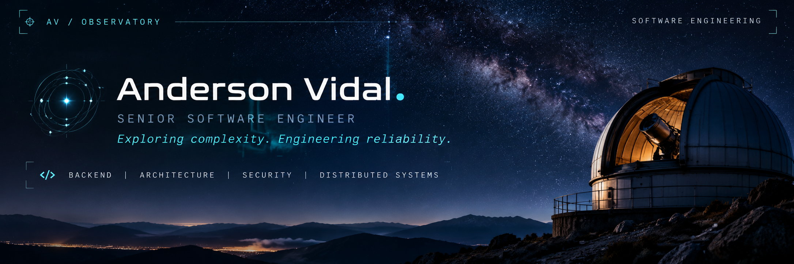

### 01 / THE OBSERVER

**Understanding complex systems is where good engineering begins.**

I'm **Anderson Vidal**, a Brazilian **Senior Software Engineer** with over **8 years of experience** building, evolving, and securing software systems.

My work focuses on backend architecture, transactional integrity, distributed services, application security, and performance. I've also served as a technical lead, supporting engineering decisions, code reviews, mentoring, and the continuous improvement of development practices.

Beyond engineering, I'm fascinated by **astronomy, physics, and artificial intelligence** — disciplines connected by a shared pursuit: understanding complexity through observation, experimentation, and reasoning.

---

### 02 / FIELDS OF EXPERTISE

| Domain | What I work on |
| :--- | :--- |
| **Backend architecture** | Designing maintainable services, APIs, and integrations |
| **Transactional systems** | Concurrency control, idempotency, and data integrity |
| **Distributed systems** | Asynchronous processing, messaging, and resilient workflows |
| **Application security** | Vulnerability remediation, incident response, and preventive hardening |
| **Performance engineering** | Query optimization, caching, and application modernization |
| **Technical leadership** | Architecture discussions, code reviews, and mentoring |

---

### 03 / ENGINEERING TOOLKIT

**Backend**  
`PHP` · `Laravel` · `Java` · `Spring Boot` · `Python`

**Frontend**  
`Vue.js` · `React` · `Angular` · `TypeScript`

**Data & messaging**  
`MySQL` · `PostgreSQL` · `Redis` · `AWS SQS`

**Infrastructure & delivery**  
`AWS` · `Docker` · `GitLab CI/CD` · `Git`

> Technologies are tools. Reliability, clarity, and sound engineering decisions are the goals.

---

### 04 / SELECTED WORK

Most of my professional experience comes from private, production systems. I'm preparing a curated selection of public projects that demonstrate how I approach architecture, testing, and engineering trade-offs.

In the meantime, you can explore my [public repositories](https://github.com/AndersonVidal?tab=repositories).

---

### 05 / BEYOND THE HORIZON

I'm currently expanding my knowledge of **AI Engineering**, including retrieval-augmented generation (RAG), intelligent applications, and the practical integration of AI into software systems.

My interests also extend to **astronomy, cosmology, and scientific research**. I enjoy exploring questions that challenge how we understand the world — and applying that same curiosity to engineering.

---

### 06 / ESTABLISH CONTACT

I'm open to conversations about **software engineering, backend architecture, AI, and technical collaboration**.

**[GitHub](https://github.com/AndersonVidal)** · **[Contact through my GitHub profile](https://github.com/AndersonVidal)**

OBSERVATORY / AV · Exploring complexity. Engineering reliability.
